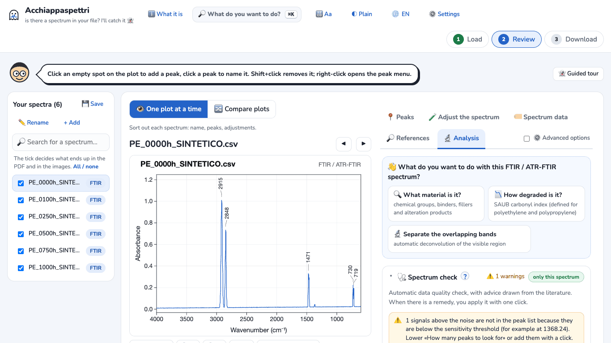
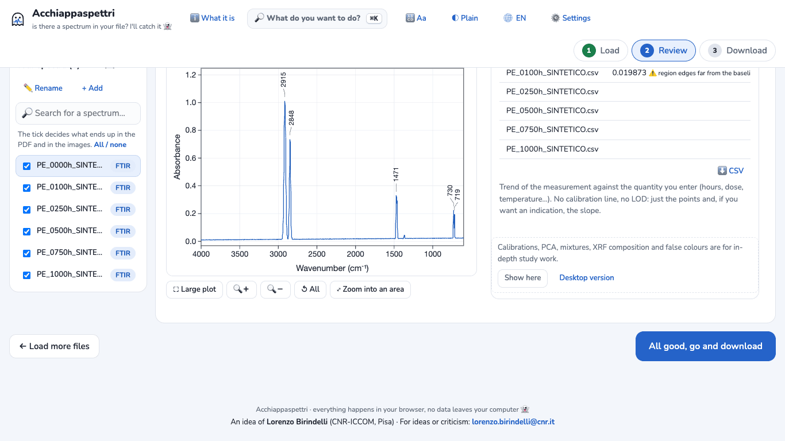
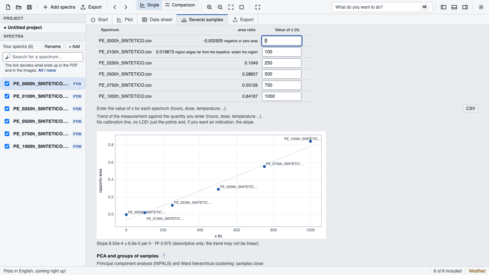
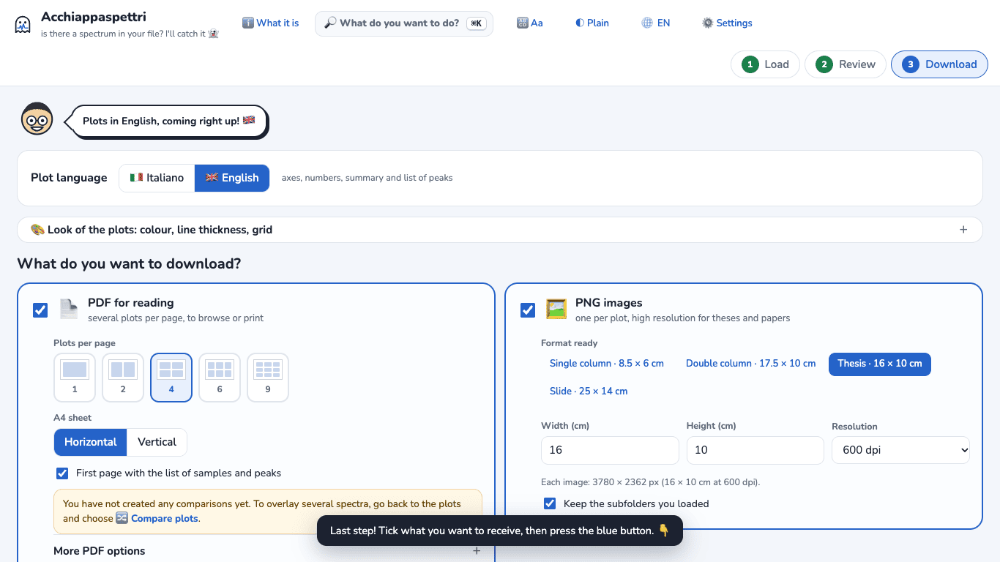
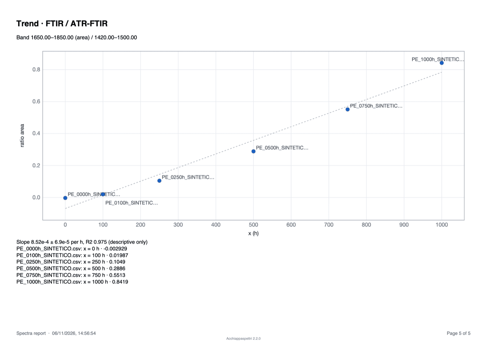

# Tutorial 1 · Carbonyl index from an FTIR series

**Goal:** from six FTIR spectra of aged polyethylene (0 to 1000 hours), get the carbonyl index, the plot of its trend over time, a PDF and a CSV file for Excel.
**Time:** about 10 minutes.
**You need:** Acchiappaspettri online (in the browser) or the desktop app. The steps are the same; where they differ, it is written.

> **SYNTHETIC example data.** The files in `examples/ftir-polietilene-sintetico/` were computed by `examples/genera-esempi-sintetici.js`. They are not real measurements. The file names (`…_SINTETICO.csv`, Italian for "synthetic") and the first line of each file say so too.

## What the carbonyl index measures
When polyethylene ages, it oxidises. A band appears between 1650 and 1850 cm⁻¹ (C=O groups). The «SAUB» carbonyl index (Almond and co-workers, 2020) is the area of this band divided by the area of the polyethylene band between 1420 and 1500 cm⁻¹. The higher it is, the more oxidised the material. The method is defined for polyethylene and polypropylene.

## 1. Load the spectra
1. Open Acchiappaspettri. The first time, a welcome window appears: press **Let's start 👻**.
2. Press **Choose files** and select the six files `PE_0000h_SINTETICO.csv` … `PE_1000h_SINTETICO.csv`. You can also drag them onto the page.
   *Desktop app:* press **Add spectra** in the top bar.
3. The program recognises the instrument by itself: **FTIR** appears next to each name.

## 2. Use English numbers and plots
The program starts with Italian plots and decimal commas (0,84), even when the menus are in English. To switch:
1. Press **3 Download** at the top. *Desktop app:* the **Export** tab.
2. Under **Plot language** choose **🇬🇧 English**.
3. Press **2 Review** to go back. *Desktop app:* the **Plot** tab.

From now on numbers use the decimal point (0.84), and the PDF and the CSV files are in English.

## 3. Ask for the carbonyl index
1. To the right of the plot, open the **🔬 Analysis** tab.
2. In the box «What do you want to do with this FTIR / ATR-FTIR spectrum?» press **📉 How degraded is it?**.
   *Desktop app:* the tab is called **Analysis** and **How degraded is it?** is a link.

The program sets the two regions of the index by itself (1650–1850 and 1420–1500 cm⁻¹) and measures all six spectra. A table appears with one row per spectrum and the column **area ratio**: this is the carbonyl index.

## 4. Enter the ageing hours
The program does not know how many hours each file corresponds to: you enter them.

1. **Online version only:** below the table there is the box «Calibrations, PCA, mixtures, XRF composition and false colours are for in-depth study work». Press **Show here**. Without this step the column for the hours does not appear.

   

2. In the column **Value of x** enter the hours, in the order of the files: `0`, `100`, `250`, `500`, `750`, `1000`. Press **Enter** after each number to move to the next row.
   In the online version the table is wider than its box: if you do not see the column, scroll the table to the right.
3. In the box **Unit of x** (above the table) enter `h`.
4. The trend plot appears below the table, with the slope.

The vertical axis of this small plot is still labelled in Italian («rapporto area» = area ratio).

## 5. Read the result
With the example files you should get these values (tested several times, online and desktop, with identical results):

| File | Hours | Carbonyl index |
|---|---|---|
| PE_0000h | 0 | −0.0029 ⚠️ negative or zero area |
| PE_0100h | 100 | 0.0199 ⚠️ region edges far from the baseline |
| PE_0250h | 250 | 0.105 |
| PE_0500h | 500 | 0.289 |
| PE_0750h | 750 | 0.551 |
| PE_1000h | 1000 | 0.842 |

Slope: 8.52e-4 ± 6.9e-5 per h, R² 0.975.

How to read them:
- **The ⚠️ warnings are normal here.** At 0 hours the sample is not oxidised: there is no band and the area is about zero. At 100 hours the band is just above the noise. The program says so instead of giving a confident number.
- **The slope is descriptive only.** The program writes it: «the trend may not be linear». Here oxidation speeds up after the first few hundred hours, so the straight line does not describe the points well. Do not use it as a degradation model.

## 6. Download the PDF and the CSV for Excel
1. Press **All good, go and download** (bottom right). *Desktop app:* press **Export** in the top bar.
2. Check that **Plot language** is **🇬🇧 English**.
3. The options already ticked are fine. Press **⬇️ Download everything in one ZIP file**.

In the ZIP file you find:
- `Spectra_report_….pdf`: the plots and, on the last page, «Trend · FTIR / ATR-FTIR» with the plot and the values;
- `analysis/band_measurements_ftir.csv`: the index table with the hours, to open in Excel (comma separator, decimal point);
- `analysis/methods_and_references.txt`: a draft «Methods» paragraph citing the SAUB method;
- the PNG images of each spectrum and the peak list.

**Faster, CSV only:** the **⬇️ CSV** button next to the index table immediately downloads `misure_ftir.csv` with the same numbers. Its column names follow the plot language.

**Note:** the ⚠️ warnings of the table (for example «negative or zero area») do **not** appear in the CSV or in the PDF. Write them down yourself before using the numbers.

## If something goes wrong
- **You do not see the «Value of x» column:** in the online version press **Show here**; then scroll the table to the right.
- **The «How degraded is it?» button is missing:** it appears only for spectra recognised as FTIR.
- **Numbers have decimal commas:** see step 2.
- **Your spectra are in transmittance:** the index must be computed in absorbance. Open the **🧪 Adjust the spectrum** tab and under **Y axis** choose **Absorbance**. The choice applies to all loaded FTIR spectra; the original files do not change.
