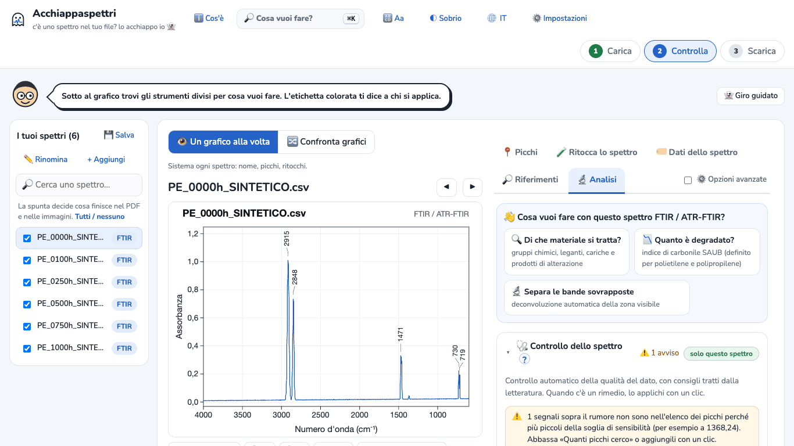
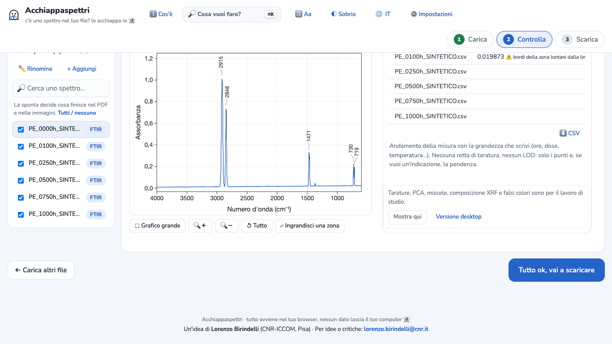
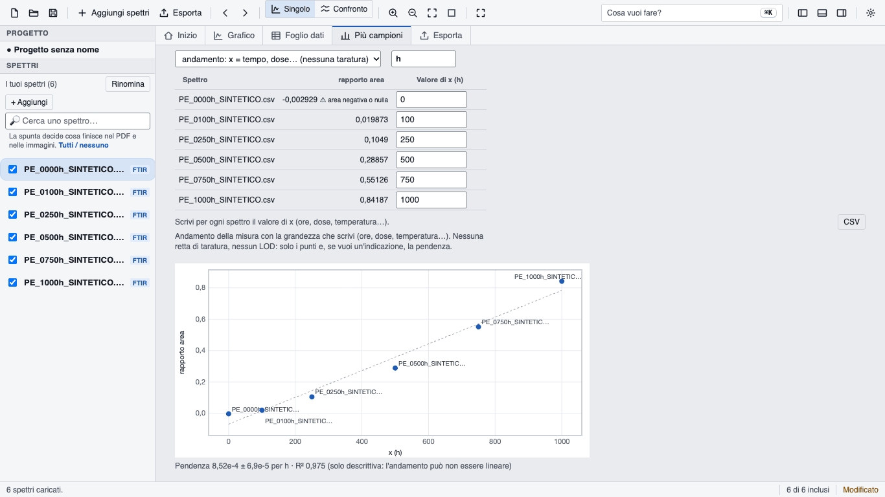
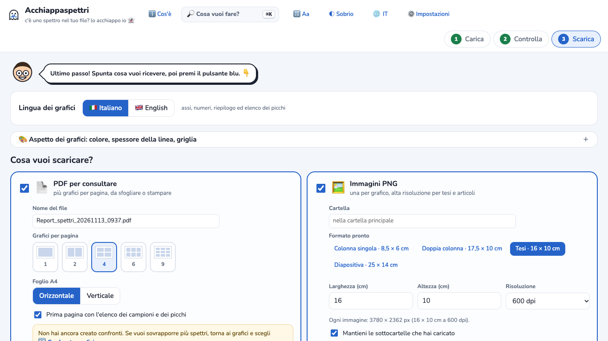
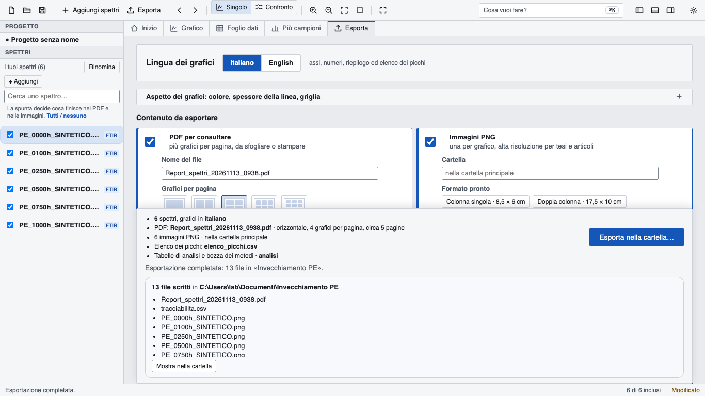
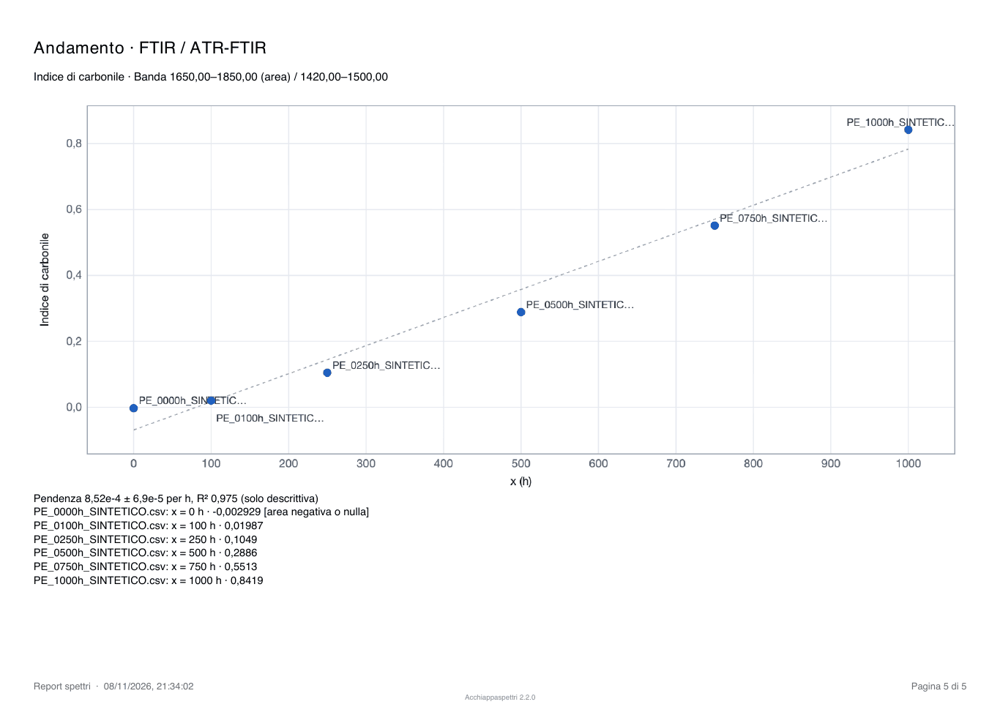

# Tutorial 1 · Indice di carbonile da una serie FTIR

**Obiettivo:** da sei spettri FTIR di polietilene invecchiato (da 0 a 1000 ore) ottenere l'indice di carbonile, il grafico dell'andamento nel tempo, un PDF e un file CSV da aprire in Excel.
**Tempo:** circa 10 minuti.
**Serve:** Acchiappaspettri online (nel browser) oppure l'app desktop. Gli stessi passi valgono per entrambe; dove cambiano, è scritto.

> **Dati d'esempio SINTETICI.** I file di `examples/ftir-polietilene-sintetico/` sono stati calcolati al computer da `examples/genera-esempi-sintetici.js`. Non sono misure reali. Lo dicono anche il nome (`…_SINTETICO.csv`) e la prima riga di ogni file.

## Che cosa misura l'indice di carbonile
Quando il polietilene invecchia, si ossida. Nello spettro compare una banda tra 1650 e 1850 cm⁻¹ (gruppi C=O). L'indice di carbonile «SAUB» (Almond e colleghi, 2020) è l'area di questa banda divisa per l'area della banda del polietilene tra 1420 e 1500 cm⁻¹. Più è alto, più il materiale è ossidato. Il metodo è definito per polietilene e polipropilene.

## 1. Carica gli spettri
1. Apri Acchiappaspettri. Nella versione online, alla prima apertura compare il benvenuto: premi **Iniziamo 👻** e poi **▶ Usa Acchiappaspettri Online**.
   *App desktop:* il benvenuto non compare. L'app si apre sulla scheda **Inizio**, con il riquadro per caricare i file.
2. Premi **Scegli file** e seleziona i sei file `PE_0000h_SINTETICO.csv` … `PE_1000h_SINTETICO.csv`. Puoi anche trascinarli sulla pagina.
   *App desktop:* premi **Aggiungi spettri** nella barra in alto.
3. Il programma riconosce da solo lo strumento: accanto a ogni nome compare **FTIR**.

## 2. Chiedi l'indice di carbonile
1. A destra del grafico apri la scheda **🔬 Analisi**.
2. Nel riquadro «Cosa vuoi fare con questo spettro FTIR / ATR-FTIR?» premi **📉 Quanto è degradato?**.
   *App desktop:* la scheda si chiama **Analisi** e la voce **Quanto è degradato?** è un collegamento.

Il programma imposta da solo le due zone dell'indice (1650–1850 e 1420–1500 cm⁻¹) e misura tutti e sei gli spettri. Compare una tabella con una riga per spettro e la colonna **rapporto area**: è l'indice di carbonile.
Nella versione online la tabella compare nella scheda **🔬 Analisi**. *App desktop:* si apre da sola la scheda **Più campioni**.

## 3. Scrivi le ore di invecchiamento
Il programma non sa quante ore corrispondono a ogni file: devi scriverlo tu.

1. Nella colonna **Valore di x** scrivi le ore, nell'ordine dei file: `0`, `100`, `250`, `500`, `750`, `1000`. Dopo ogni numero premi **Invio**: passi alla riga sotto.
   Finché mancano le ore, sotto la tabella un avviso giallo dice che gli spettri non sono nel grafico: è normale, sparisce quando scrivi i valori.
2. Nella casella **Unità di x** (sopra la tabella) scrivi `h`.
3. Sotto la tabella compare il grafico dell'andamento, con la pendenza.

## 4. Leggi il risultato
Con i file d'esempio devi ottenere questi valori (provati più volte, online e desktop, con risultati identici):

| File | Ore | Indice di carbonile |
|---|---|---|
| PE_0000h | 0 | −0,0029 ⚠️ area negativa o nulla |
| PE_0100h | 100 | 0,0199 |
| PE_0250h | 250 | 0,105 |
| PE_0500h | 500 | 0,289 |
| PE_0750h | 750 | 0,551 |
| PE_1000h | 1000 | 0,842 |

Pendenza: 8,52e-4 ± 6,9e-5 per h, R² 0,975.

La pendenza è «per h» perché in **Unità di x** hai scritto `h`: la stessa unità compare a schermo, nel PDF e nella riga «Andamento» del CSV. Se lasci la casella vuota, il programma scrive «per unità di x».

Come leggerli:
- **L'avviso ⚠️ a 0 ore è normale.** Il campione non è ancora ossidato: la banda non c'è e l'area è circa zero (qui un po' sotto lo zero, per il rumore). Il programma lo dice invece di dare un numero sicuro.
- **A 100 ore la banda è appena sopra il rumore.** Il programma non dà avvisi, ma il valore è piccolo e incerto: non dargli troppo peso.
- **La pendenza è solo descrittiva.** Il programma lo scrive: «l'andamento può non essere lineare». Qui l'ossidazione accelera dopo le prime centinaia di ore, quindi la retta non descrive bene i punti. Non usarla come modello di degradazione.

## 5. Scarica il PDF e il CSV per Excel
1. Premi **Tutto ok, vai a scaricare** (in basso a destra).
   *App desktop:* premi **Esporta** nella barra in alto.
2. In «Lingua dei grafici» lascia **🇮🇹 Italiano**.
3. Le voci già spuntate vanno bene (PDF, immagini PNG, elenco dei picchi, risultati delle analisi, tracciabilità). Ogni voce ha un nome di file proposto, che puoi cambiare.
4. Online: premi **⬇️ Scarica i file scelti**. Sono più di 3 file, quindi l'app propone di raccoglierli in uno ZIP: rispondi **Sì, un file ZIP** (oppure **No, uno per uno**). Se vuoi sempre lo ZIP, spunta **Raccogli tutto in un file ZIP**.
   *App desktop:* premi **Esporta nella cartella…**, scegli la cartella e i file vengono scritti lì; alla fine **Mostra nella cartella** la apre.

Nella cartella (o nello ZIP) trovi:
- `Report_spettri_….pdf`: i grafici e, nell'ultima pagina, «Andamento · FTIR / ATR-FTIR» con il grafico e i valori;
- `analisi/misure_bande_ftir.csv`: la tabella dell'indice con le ore, da aprire in Excel (separatore punto e virgola, decimali con la virgola). L'ultima colonna, **Stato**, riporta gli avvisi;
- `analisi/metodi_e_bibliografia.txt`: una bozza del paragrafo «Metodi» con la citazione del metodo SAUB;
- le immagini PNG di ogni spettro e l'elenco dei picchi.

**Più veloce, solo il CSV:** il pulsante **⬇️ CSV** accanto alla tabella dell'indice scarica subito `misure_ftir.csv`, con gli stessi numeri.

**Gli avvisi restano anche nei file.** Un avviso ⚠️ della tabella (per esempio «area negativa o nulla») compare nella colonna **Stato** dei due CSV e, tra parentesi quadre, accanto al valore nell'ultima pagina del PDF. Controllali prima di usare i numeri.

## Se qualcosa non va
- **Non vedi la colonna «Valore di x»:** nella versione online, se sotto la scheda c'è il riquadro «Tarature, PCA, miscele, composizione XRF e falsi colori sono per il lavoro di studio», premi **Mostra qui**. Di solito non serve: **Quanto è degradato?** mostra la colonna da solo.
- **Il pulsante «Quanto è degradato?» non c'è:** compare solo per gli spettri riconosciuti come FTIR.
- **I tuoi spettri sono in trasmittanza percentuale (valori da 0 a 100):** non devi fare niente. Il programma la riconosce e calcola l'indice in assorbanza da solo: i numeri sono gli stessi della tabella sopra.
- **I tuoi spettri sono in trasmittanza da 0 a 1 (frazione):** questa è la trappola. Se il file non dice che è trasmittanza, i valori da 0 a 1 sembrano assorbanza, le bande vengono lette capovolte e l'indice sarebbe sbagliato (con questi esempi 1,01 invece di 0,842). Per questo il programma non dà il valore e scrive ⚠️ «trasmittanza letta come assorbanza». Rimedio: per **ogni** spettro, apri la scheda **🏷️ Dati dello spettro** (*app desktop:* **Dati**) e in **Asse Y** scegli **trasmittanza %**. La scelta vale per un solo spettro: ripetila per tutti e sei. Poi l'indice torna quello giusto. I file originali non cambiano.
