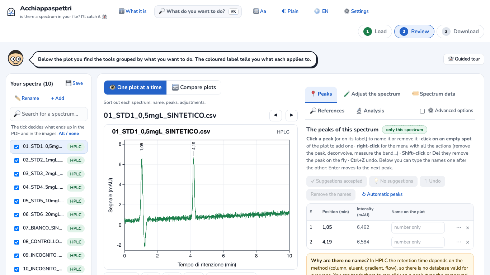
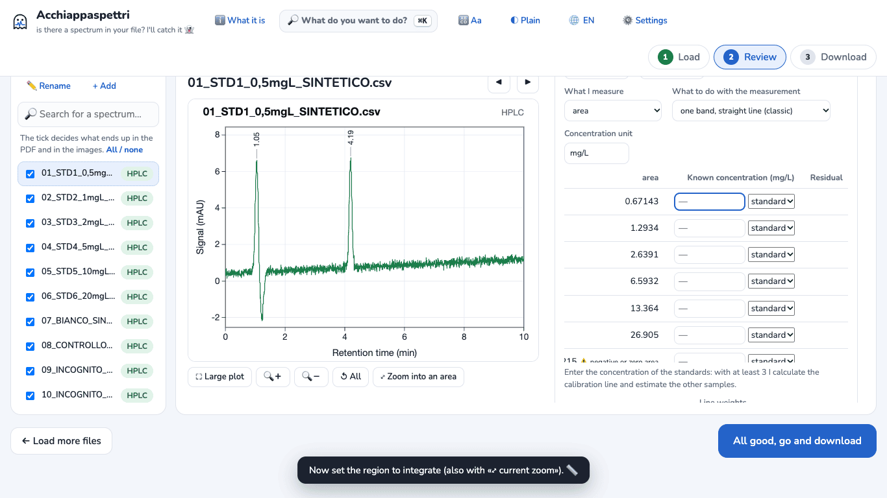
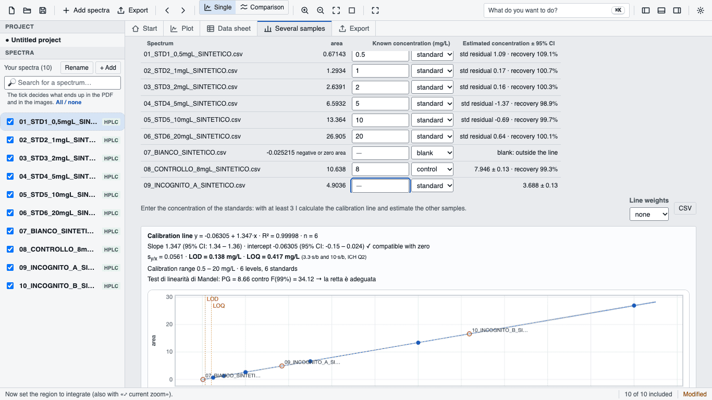

# Tutorial 2 · HPLC calibration: line, LOD, LOQ and concentrations

**Goal:** with 6 standards, a blank, a control and 2 unknown samples, get the calibration line, the limit of detection (LOD), the limit of quantification (LOQ) and the concentration of the unknowns with its interval.
**Time:** about 10 minutes.
**You need:** Acchiappaspettri online or the desktop app. Where the steps differ, it is written.

> **SYNTHETIC example data.** The 10 chromatograms in `examples/hplc-taratura-sintetico/` were computed by `examples/genera-esempi-sintetici.js`. They are not real measurements. The file names (`…_SINTETICO.csv`, Italian for "synthetic") and the first line of each file say so. These «true» values were used to build them: control 8 mg/L, unknown A 3.7 mg/L, unknown B 12.4 mg/L. So you can check the result.

The files (names are in Italian: BIANCO = blank, CONTROLLO = control, INCOGNITO = unknown):

| File | What it is | Concentration |
|---|---|---|
| 01 … 06 `STD…` | standards | 0.5 · 1 · 2 · 5 · 10 · 20 mg/L |
| 07 `BIANCO` | blank (solvent only) | — |
| 08 `CONTROLLO_8mgL` | quality control | 8 mg/L |
| 09 `INCOGNITO_A`, 10 `INCOGNITO_B` | samples to measure | to be found |

## 1. Load the chromatograms
1. Open Acchiappaspettri. If the welcome window appears, press **Let's start 👻**.
2. Press **Choose files** and select the 10 files. *Desktop app:* **Add spectra** in the top bar.
3. **HPLC** appears next to each name: the program has recognised the chromatograms.
4. With the menus in English, plots and numbers are in English too (decimal point: 0.5). Only if you want them in Italian, change **Plot language** on the download page (*desktop app:* the **Export** tab).

Look at the plot: the compound to measure is the peak at about **4.2 minutes**. The peak at 1.05 minutes is the solvent front: do not measure it.

## 2. Open the calibration
**Online version**
1. To the right of the plot, open the **🔬 Analysis** tab.
2. Scroll down and click the title **📊 Several samples: measure the same band**.
3. In the box at the bottom («Calibrations, PCA, mixtures…») press **Show here**. The title becomes **📊 Several samples: measurements, calibration, PCA and groups**.

**Desktop app:** open the **Several samples** tab at the top, above the plot.

## 3. Tell the program what to measure
1. In **Indices and measurements from the literature** choose **Area of a peak (external calibration)**.
2. In **Band: from** enter `3.9` and in **to** enter `4.5`. These are the minutes between which the program computes the area. The region must contain the whole peak, with some baseline on both sides.
3. **What I measure** is already set to **area**. **What to do with the measurement** is already set to **one band, straight line (classic)**.
4. In **Concentration unit** enter `mg/L`.

The table shows the peak area of each file.

## 4. Enter the concentrations and the roles
Each row of the table has a **Known concentration** box and, next to it, a menu with three choices: **standard**, **blank**, **control**. Only the standards go into the line.

1. Click the box of the first row and enter the concentrations of the standards: `0.5`, `1`, `2`, `5`, `10`, `20`. Press **Enter** after each number to move to the next row.
2. Row `07_BIANCO`: leave the concentration empty and choose **blank** in the menu.
3. Row `08_CONTROLLO_8mgL`: choose **control** in the menu and enter `8` as the concentration.
4. Rows `09_INCOGNITO_A` and `10_INCOGNITO_B`: leave them as they are (empty concentration). The program estimates them.

In the online version the table is wider than its box: scroll the table to the right to see the estimates. The desktop app shows the whole table.

## 5. Read the result
Below the table the **Calibration line** box appears. With the example files (tested several times, online and desktop, always with the same numbers):

- **Calibration line** y = −0.06305 + 1.347·x · R² = 0.99998 · n = 6
- intercept compatible with zero (✓)
- **LOD = 0.138 mg/L** · **LOQ = 0.417 mg/L** (3.3·s/b and 10·s/b, as in the ICH Q2 guideline)
- **Calibration range** 0.5 – 20 mg/L · 6 levels, 6 standards
- the Mandel linearity test: this line is still in Italian on screen, «Test di linearità di Mandel … la retta è adeguata», which means «the straight line is adequate»

In the column **Estimated concentration ± 95% CI**:

| Sample | Result | Value used to build the file |
|---|---|---|
| Control | 7.946 ± 0.13 mg/L · recovery 99.3% | 8 |
| Unknown A | 3.688 ± 0.13 mg/L | 3.7 |
| Unknown B | 12.37 ± 0.13 mg/L | 12.4 |
| Blank | «blank: outside the line», negative or zero area | 0 |

How to read them:
- **± 0.13** is the 95% confidence interval of the single measurement, computed from the line.
- **The control** checks the line: the recovery (99.3%) is close to 100%. Outside 80–120% the program adds ⚠️.
- **The blank** has no peak: good, no contamination. If the blank gave a value above the LOD, the program would write «contamination?».
- An unknown outside the 0.5–20 mg/L range is marked **⚠️ extrapolated**; below the LOD or LOQ you see **< LOD** or **< LOQ**.
- If the program says that the scatter grows with concentration, try the **Line weights** menu (1/x or 1/x²).

## 6. Download the results
- **Table only:** press **⬇️ CSV** below the table. You get `misure_hplc.csv` for Excel: areas, estimated concentrations, interval, status of each row, and at the end the line, LOD, LOQ and Mandel test. Its column names follow the plot language.
- **Everything:** press **All good, go and download** (*desktop app:* **Export**), keep **PDF** and **Analysis results** ticked and press **⬇️ Download the chosen files** (*desktop app:* **Export to folder…** and choose the folder). If you want a single file, first tick **Collect everything in one ZIP file**. The last page of the PDF is «Calibration line · HPLC» with line, LOD, LOQ, control, blank and unknowns. The analysis results also include `analysis/band_measurements_hplc.csv`.

## If something goes wrong
- **⚠️ «region edges far from the baseline: widen the region or interferent» appears next to the area:** the region cuts the peak. Widen it (for example 3.8–4.6) while looking at the plot.
- **A number is not accepted:** use the comma or the point only for decimals, without a thousands separator.
- **You do not see the concentration column:** in the online version press **Show here**.
- **With your instrument the peak is elsewhere:** use the minutes of your peak. You can also zoom into the peak on the plot and press **⤢ current zoom** next to the region.
