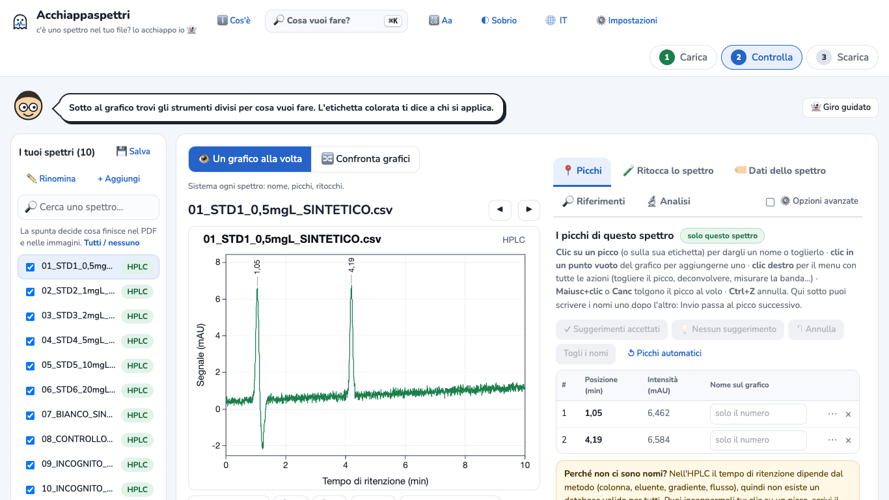
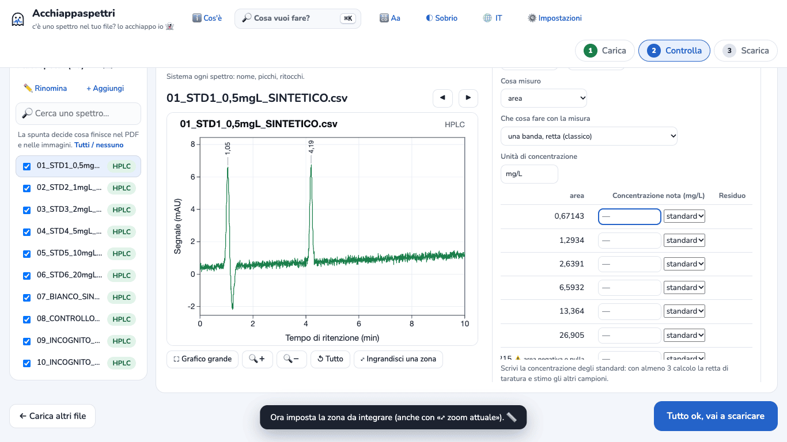
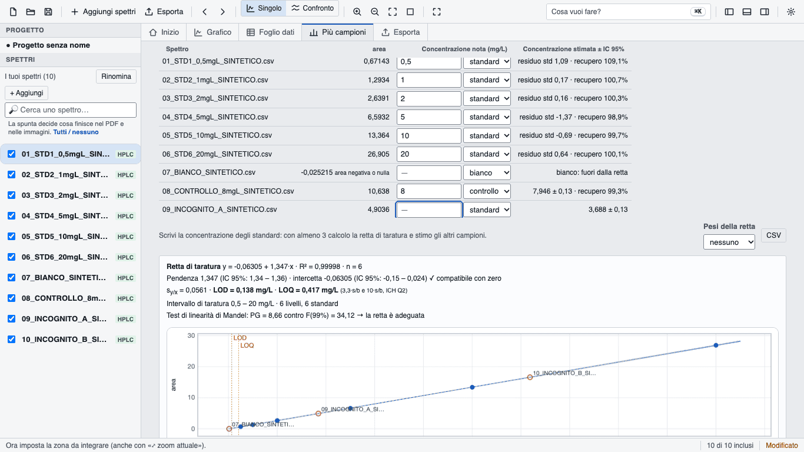

# Tutorial 2 · Taratura HPLC: retta, LOD, LOQ e concentrazioni

**Obiettivo:** con 6 standard, un bianco, un controllo e 2 campioni incogniti ottenere la retta di taratura, il limite di rilevabilità (LOD), il limite di quantificazione (LOQ) e la concentrazione degli incogniti con il suo intervallo.
**Tempo:** circa 10 minuti.
**Serve:** Acchiappaspettri online oppure l'app desktop. Dove i passi cambiano, è scritto.

> **Dati d'esempio SINTETICI.** I 10 cromatogrammi di `examples/hplc-taratura-sintetico/` sono stati calcolati al computer da `examples/genera-esempi-sintetici.js`. Non sono misure reali. Lo dicono il nome (`…_SINTETICO.csv`) e la prima riga di ogni file. Per costruirli sono stati usati questi valori «veri»: controllo 8 mg/L, incognito A 3,7 mg/L, incognito B 12,4 mg/L. Così puoi controllare il risultato.

I file:

| File | Che cos'è | Concentrazione |
|---|---|---|
| 01 … 06 `STD…` | standard | 0,5 · 1 · 2 · 5 · 10 · 20 mg/L |
| 07 `BIANCO` | bianco (solo solvente) | — |
| 08 `CONTROLLO_8mgL` | controllo di qualità | 8 mg/L |
| 09 `INCOGNITO_A`, 10 `INCOGNITO_B` | campioni da misurare | da trovare |

## 1. Carica i cromatogrammi
1. Apri Acchiappaspettri. Se compare il benvenuto, premi **Iniziamo 👻**.
2. Premi **Scegli file** e seleziona i 10 file. *App desktop:* **Aggiungi spettri** nella barra in alto.
3. Accanto a ogni nome compare **HPLC**: il programma ha riconosciuto i cromatogrammi.

Guarda il grafico: il composto da misurare è il picco a circa **4,2 minuti**. Il picco a 1,05 minuti è il fronte del solvente: non va misurato.

## 2. Apri la taratura
**Versione online**
1. A destra del grafico apri la scheda **🔬 Analisi**.
2. Scorri in basso e clicca sul titolo **📊 Più campioni: misura la stessa banda**.
3. Nel riquadro in fondo («Tarature, PCA, miscele…») premi **Mostra qui**. Il titolo diventa **📊 Più campioni: misure, taratura, PCA e gruppi**.

**App desktop:** apri la scheda **Più campioni** in alto, sopra il grafico.

## 3. Dì al programma che cosa misurare
1. In **Indici e misure dalla letteratura** scegli **Area di un picco (taratura esterna)**.
2. In **Banda: da** scrivi `3,9` e in **a** scrivi `4,5`. Sono i minuti tra cui il programma calcola l'area. La zona deve contenere tutto il picco, con un po' di linea di base ai lati.
3. **Cosa misuro** è già su **area**. **Che cosa fare con la misura** è già su **una banda, retta (classico)**.
4. In **Unità di concentrazione** scrivi `mg/L`.

Nella tabella compare l'area del picco di ogni file.

## 4. Scrivi le concentrazioni e i ruoli
Ogni riga della tabella ha una casella **Concentrazione nota** e, accanto, un menu con tre scelte: **standard**, **bianco**, **controllo**. Solo gli standard entrano nella retta.

1. Clicca nella casella della prima riga e scrivi le concentrazioni degli standard: `0,5`, `1`, `2`, `5`, `10`, `20`. Dopo ogni numero premi **Invio** per passare alla riga sotto.
2. Riga `07_BIANCO`: lascia vuota la concentrazione e nel menu scegli **bianco**.
3. Riga `08_CONTROLLO_8mgL`: nel menu scegli **controllo** e scrivi `8` nella concentrazione.
4. Righe `09_INCOGNITO_A` e `10_INCOGNITO_B`: lascia tutto com'è (concentrazione vuota). Il programma le stima.

Nella versione online la tabella è più larga del riquadro: scorri la tabella verso destra per vedere le stime. L'app desktop mostra tutta la tabella.

## 5. Leggi il risultato
Sotto la tabella compare il riquadro **Retta di taratura**. Con i file d'esempio (provati più volte, online e desktop, sempre con gli stessi numeri):

- **Retta di taratura** y = −0,06305 + 1,347·x · R² = 0,99998 · n = 6
- intercetta compatibile con zero (✓)
- **LOD = 0,138 mg/L** · **LOQ = 0,417 mg/L** (3,3·s/b e 10·s/b, come nella linea guida ICH Q2)
- **Intervallo di taratura** 0,5 – 20 mg/L · 6 livelli, 6 standard
- **Test di linearità di Mandel**: la retta è adeguata

Nella colonna **Concentrazione stimata ± IC 95%**:

| Campione | Risultato | Valore usato per costruire il file |
|---|---|---|
| Controllo | 7,946 ± 0,13 mg/L · recupero 99,3% | 8 |
| Incognito A | 3,688 ± 0,13 mg/L | 3,7 |
| Incognito B | 12,37 ± 0,13 mg/L | 12,4 |
| Bianco | «bianco: fuori dalla retta», area negativa o nulla | 0 |

Come leggerli:
- **± 0,13** è l'intervallo di confidenza al 95% della singola misura, calcolato dalla retta.
- **Il controllo** serve a verificare la retta: il recupero (99,3%) è vicino al 100%. Fuori da 80–120% il programma mette ⚠️.
- **Il bianco** non ha picco: bene, niente contaminazione. Se il bianco desse un valore sopra il LOD, il programma scriverebbe «contaminazione?».
- Un incognito fuori dall'intervallo 0,5–20 mg/L viene segnato **⚠️ estrapolato**; sotto LOD o LOQ compare **< LOD** o **< LOQ**.
- Se il programma scrive che la dispersione cresce con la concentrazione, prova il menu **Pesi della retta** (1/x o 1/x²).

## 6. Scarica i risultati
- **Solo la tabella:** premi **⬇️ CSV** sotto la tabella. Ottieni `misure_hplc.csv` per Excel: aree, concentrazioni stimate, intervallo, stato di ogni riga, e in fondo retta, LOD, LOQ e test di Mandel.
- **Tutto:** premi **Tutto ok, vai a scaricare** (*app desktop:* **Esporta**), poi **⬇️ Scarica tutto in un file ZIP**. Nel PDF l'ultima pagina è «Retta di taratura · HPLC» con retta, LOD, LOQ, controllo, bianco e incogniti. Nello ZIP c'è anche `analisi/misure_bande_hplc.csv`.

## Se qualcosa non va
- **Accanto all'area compare ⚠️ «bordi della zona lontani dalla linea di base»:** la zona taglia il picco. Allargala (per esempio 3,8–4,6) guardando il grafico.
- **Il numero non viene accettato:** usa la virgola o il punto solo per i decimali, senza separatore delle migliaia.
- **Non vedi la colonna delle concentrazioni:** nella versione online premi **Mostra qui**.
- **Con il tuo strumento il picco è in un altro punto:** usa i minuti del tuo picco. Puoi anche ingrandire il picco nel grafico e premere **⤢ zoom attuale** accanto alla zona.
