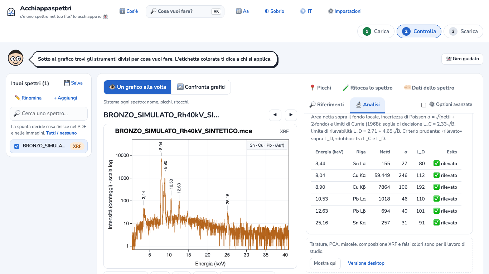
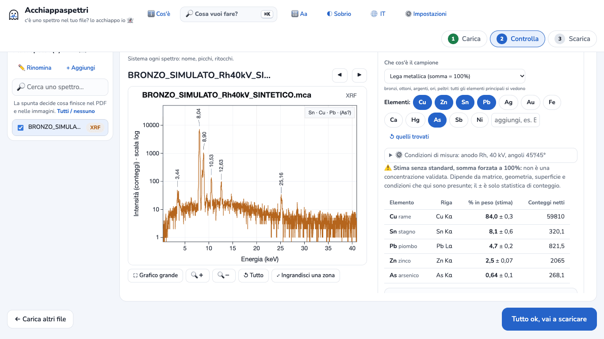
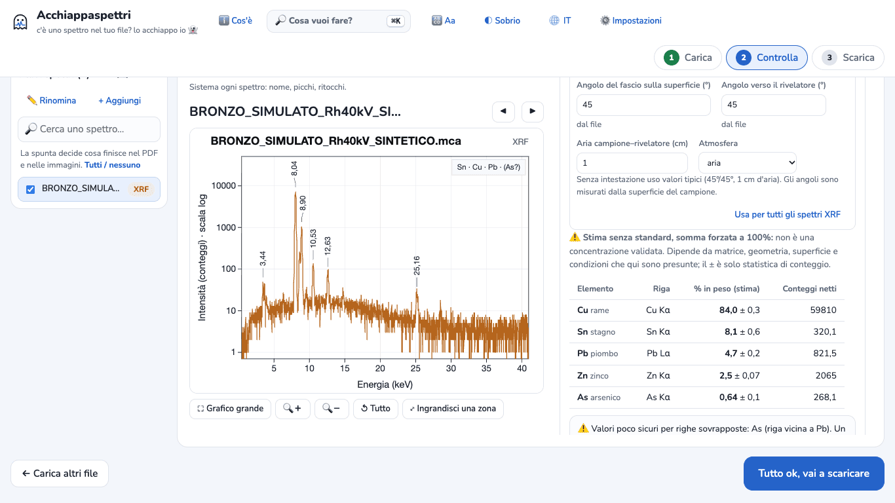
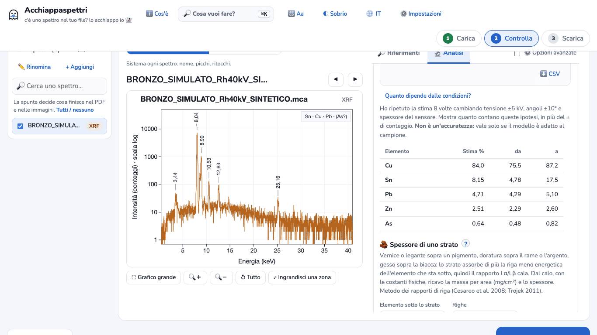

# Tutorial 3 · Composizione XRF di una lega senza standard, e i suoi limiti

**Obiettivo:** da uno spettro XRF di una lega di rame ottenere una **stima** della composizione in % in peso con i parametri fondamentali, e capire quanto ci si può fidare.
**Tempo:** circa 10 minuti.
**Serve:** Acchiappaspettri online oppure l'app desktop. Dove i passi cambiano, è scritto.

> **Dati d'esempio SINTETICI.** Il file `examples/xrf-lega-sintetico/BRONZO_SIMULATO_Rh40kV_SINTETICO.mca` è stato calcolato al computer da `examples/genera-esempi-sintetici.js`, con il modello fisico dello stesso Acchiappaspettri. Non è una misura reale. Lo dicono il nome e l'intestazione del file. Composizione usata per costruirlo: **Cu 84 · Sn 8 · Pb 5 · Zn 2,5 · As 0,5** (% in peso); tubo con anodo di rodio (Rh) a 40 kV, angoli 45°/45°.

> **Prima di cominciare.** Senza standard il risultato è una **stima non validata**. Il programma lo scrive sopra ogni tabella, nel PDF e nel CSV. Non usarlo come analisi certificata.

## 1. Carica lo spettro
1. Apri Acchiappaspettri. Se compare il benvenuto, premi **Iniziamo 👻**.
2. Premi **Scegli file** e scegli il file `.mca`. *App desktop:* **Aggiungi spettri** nella barra in alto.
3. Accanto al nome compare **XRF**. Il programma ha letto dall'intestazione del file l'anodo (Rh), la tensione (40 kV) e gli angoli.

## 2. Apri la composizione senza standard
**Versione online**
1. A destra del grafico apri la scheda **🔬 Analisi**.
2. Scorri fino al riquadro «Tarature, PCA, miscele, composizione XRF e falsi colori sono per il lavoro di studio» e premi **Mostra qui**.

   

3. Torna in alto nella scheda. Nel riquadro «Cosa vuoi fare con questo spettro XRF?» premi **🏛️ Stima della composizione in % senza standard**.

**App desktop:** nella scheda **Analisi** a destra clicca **Stima della composizione in % senza standard**.

Si apre la sezione **🏛️ Concentrazioni XRF: composizione e spessori**. In **Che cos'è il campione** lascia **Lega metallica (somma = 100%)**.

## 3. Controlla gli elementi
Il programma propone da solo gli elementi che ha trovato: qui **Cu, Sn, Pb**. Il primo risultato è:

Cu 86,3 · Sn 8,3 · Pb 5,4

**Mancano lo zinco e l'arsenico.** La somma è forzata a 100%: se manca un elemento, la sua quota finisce sugli altri. Per questo il rame risulta troppo alto.

Come accorgersene:
- il riquadro in alto a destra sul grafico scrive **(As?)**: l'arsenico è possibile ma non sicuro;
- nella sezione **🩺 Controllo del dato** (*app desktop:* scheda **Controllo del dato** sotto il grafico) il programma segnala segnali non elencati, tra cui uno a **8,63 keV**: è la riga Kα dello zinco, nascosta tra le due righe del rame.

Aggiungi gli elementi: nella riga **Elementi:** premi **Zn** e poi **As**. Il pulsante diventa blu e il calcolo riparte.

## 4. Leggi il risultato
Con il file d'esempio (provato più volte, online e desktop, sempre con gli stessi numeri):

| Elemento | Stima (% in peso) | Valore usato per costruire il file |
|---|---|---|
| Cu | 84,0 ± 0,3 | 84 |
| Sn | 8,1 ± 0,6 | 8 |
| Pb | 4,7 ± 0,2 | 5 |
| Zn | 2,5 ± 0,07 | 2,5 |
| As | 0,64 ± 0,1 | 0,5 |

Sotto la tabella il programma aggiunge:
- **⚠️ Valori poco sicuri per righe sovrapposte: As (riga vicina a Pb).** La riga Kα dell'arsenico e la riga Lα del piombo cadono quasi alla stessa energia (circa 10,5 keV). L'arsenico potrebbe anche non esserci: serve una seconda riga per confermarlo.
- **Elementi considerati.** Ciò che non è in elenco non viene cercato né contato.
- **± = solo statistica di conteggio.** Non comprende gli errori del modello.

**Attenzione: qui l'accordo è migliore che nella realtà.** Il file è stato costruito con lo stesso modello fisico che il programma usa per il calcolo e con le stesse condizioni. Il programma stesso scrive che su leghe simulate con tubo e rivelatore diversi da quelli presunti l'errore relativo ha mediana di circa 3–4%, ma arriva al 20–30% per un caso su dieci, e di più per gli elementi sotto il 2–3%.

## 5. I limiti da dichiarare
**1. È una stima, non una concentrazione validata.** Dipende da matrice, geometria, superficie e condizioni presunte. Patine, corrosione, dorature e superfici ruvide cambiano ciò che l'XRF vede: misura su una zona pulita. Con **uno standard simile** l'errore scende a circa 1%: il programma lo propone in «Più campioni» → composizione, modello «parametri fondamentali».

**2. Anodo e tensione (kV) devono essere quelli veri.** Apri **⚙️ Condizioni di misura**. Accanto ad anodo, tensione e angoli c'è scritto **dal file**: sono stati letti dall'intestazione.

Se il tuo file non li contiene, il programma usa valori tipici e lo dice con un avviso ⚠️. Scrivi i valori del tuo strumento: con anodo o tensione sbagliati gli elementi pesanti (Sn, Ag, Pb) cambiano molto. Se lo strumento usa un **filtro primario**, dichiaralo: le caselle si vedono spuntando **⚙️ Opzioni avanzate** in alto nella scheda.

**3. Quanto contano queste ipotesi.** Premi **Quanto dipende dalle condizioni?**. Il programma ripete la stima 8 volte cambiando tensione (±5 kV), angoli (±10°) e spessore del sensore.

Con il file d'esempio lo stagno può andare da 4,78 a 17,5%, il rame da 75,5 a 87,2%. Il piombo e lo zinco cambiano poco. Se non conosci bene le condizioni dello strumento, riporta questi intervalli, non solo il numero centrale.

**4. Righe sovrapposte.** Oltre ad As/Pb, controlla sempre che gli elementi proposti abbiano più di una riga visibile, e che non manchi un elemento nascosto vicino a un picco grande (come lo zinco qui).

## 6. Scarica i risultati
- **Solo la tabella:** premi **⬇️ CSV** sotto le note. Ottieni `composizione_FP_BRONZO_SIMULATO_Rh40kV_SINTETICO.csv`.
- **Tutto:** premi **Tutto ok, vai a scaricare** (*app desktop:* **Esporta**), lascia spuntati **PDF** e **Risultati delle analisi** e premi **⬇️ Scarica i file scelti** (*app desktop:* **Esporta nella cartella…** e scegli la cartella; con **Raccogli tutto in un file ZIP** ottieni un solo file). Trovi:
  - `analisi/composizione_xrf_parametri_fondamentali.csv`: ogni elemento con la % in peso, il ±, anodo, kV, angoli e la colonna «Tipo di valore» = «stima senza standard, non validata»;
  - il PDF: nella pagina «Analisi: controllo dei dati e ipotesi» c'è la riga «Stima senza standard, non validata (parametri fondamentali)» con la composizione, le condizioni e gli avvisi.

## Se qualcosa non va
- **La sezione 🏛️ non compare:** lo spettro deve essere riconosciuto come XRF e avere la scala in energia (keV). Nella versione online premi prima **Mostra qui**.
- **«Non trovo il picco Compton del tubo»:** compare solo con «Strato pittorico o preparazione». Per le leghe usa **Lega metallica (somma = 100%)**.
- **Qualità dell'adattamento con χ² ridotto alto:** forse manca un elemento nell'elenco. Qui, prima di aggiungere Zn e As, era 2,1; dopo, 1,2.
