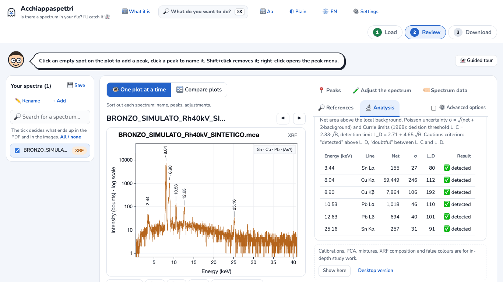
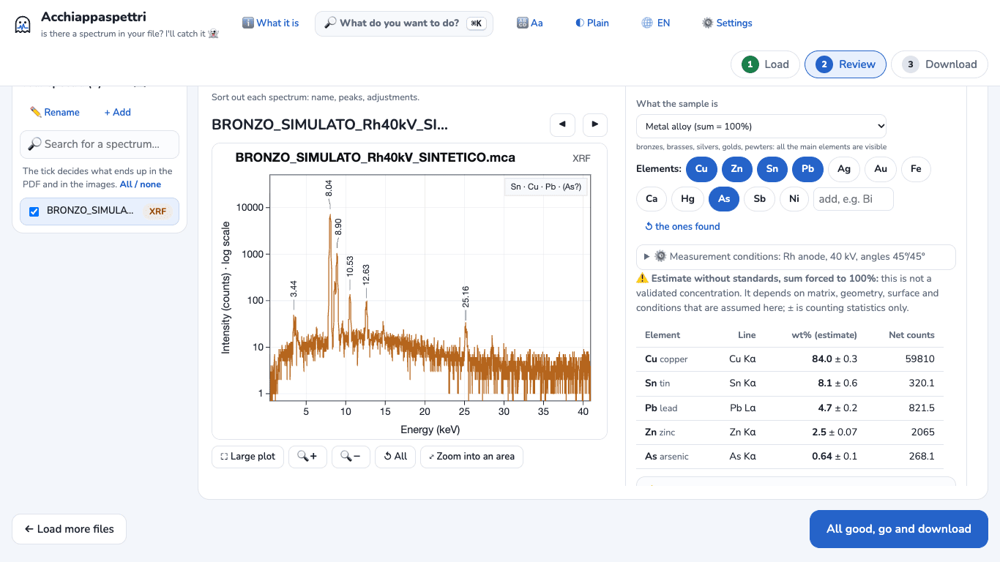
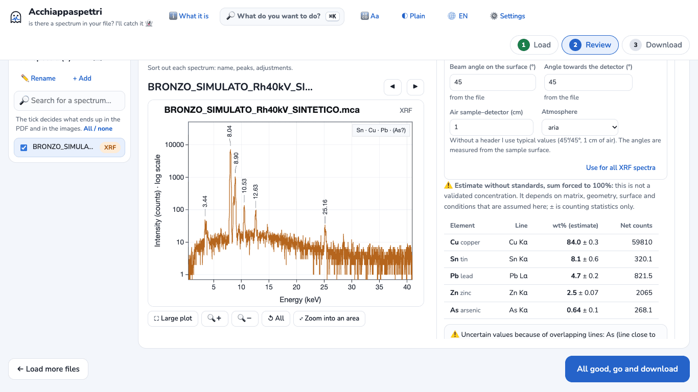
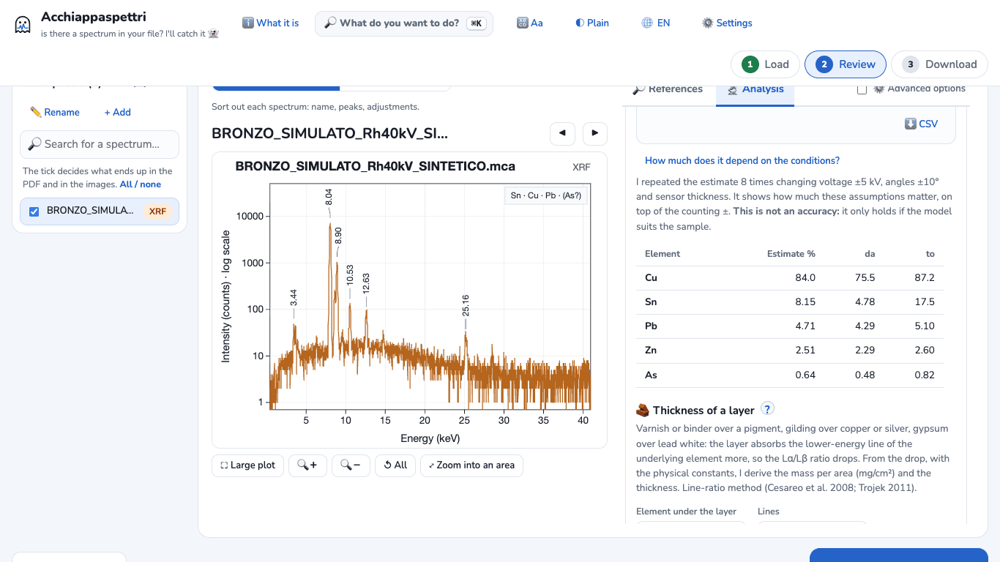

# Tutorial 3 · Standardless XRF composition of an alloy, and its limits

**Goal:** from an XRF spectrum of a copper alloy, get an **estimate** of the composition in weight % with fundamental parameters, and understand how far you can trust it.
**Time:** about 10 minutes.
**You need:** Acchiappaspettri online or the desktop app. Where the steps differ, it is written.

> **SYNTHETIC example data.** The file `examples/xrf-lega-sintetico/BRONZO_SIMULATO_Rh40kV_SINTETICO.mca` was computed by `examples/genera-esempi-sintetici.js`, with the physical model of Acchiappaspettri itself. It is not a real measurement. Its name and its header say so. Composition used to build it: **Cu 84 · Sn 8 · Pb 5 · Zn 2.5 · As 0.5** (weight %); rhodium (Rh) anode tube at 40 kV, angles 45°/45°.

> **Before you start.** Without standards the result is an **estimate, not validated**. The program writes this above every table, in the PDF and in the CSV. Do not use it as a certified analysis.

## 1. Load the spectrum
1. Open Acchiappaspettri. If the welcome window appears, press **Let's start 👻**.
2. Press **Choose files** and pick the `.mca` file. *Desktop app:* **Add spectra** in the top bar.
3. **XRF** appears next to the name. The program has read the anode (Rh), the voltage (40 kV) and the angles from the file header.
4. For English numbers and plots: press **3 Download** at the top (*desktop app:* the **Export** tab), choose **🇬🇧 English** under **Plot language**, then press **2 Review** (*desktop app:* the **Plot** tab). Without this step the program uses Italian plots and decimal commas.

## 2. Open the standardless composition
**Online version**
1. To the right of the plot, open the **🔬 Analysis** tab.
2. Scroll to the box «Calibrations, PCA, mixtures, XRF composition and false colours are for in-depth study work» and press **Show here**.

   

3. Go back to the top of the tab. In the box «What do you want to do with this XRF spectrum?» press **🏛️ Composition estimate in % without standards**.

**Desktop app:** in the **Analysis** tab on the right, click **Composition estimate in % without standards**.

The section **🏛️ XRF concentrations: composition and thicknesses** opens. Leave the sample type on **Metal alloy (sum = 100%)**.

## 3. Check the elements
The program proposes the elements it found by itself: here **Cu, Sn, Pb**. The first result is:

Cu 86.3 · Sn 8.3 · Pb 5.4

**Zinc and arsenic are missing.** The sum is forced to 100%: if an element is missing, its share goes to the others. This is why copper comes out too high.

How to notice:
- the box at the top right of the plot says **(As?)**: arsenic is possible but not certain;
- in the section **🩺 Spectrum check** (*desktop app:* the **Data check** tab below the plot) the program reports signals that are not in the peak list, among them one at **8.63 keV**: it is the zinc Kα line, hidden between the two copper lines.

Add the elements: in the **Elements:** row press **Zn** and then **As**. The button turns blue and the calculation runs again.

## 4. Read the result
With the example file (tested several times, online and desktop, always with the same numbers):

| Element | Estimate (wt %) | Value used to build the file |
|---|---|---|
| Cu | 84.0 ± 0.3 | 84 |
| Sn | 8.1 ± 0.6 | 8 |
| Pb | 4.7 ± 0.2 | 5 |
| Zn | 2.5 ± 0.07 | 2.5 |
| As | 0.64 ± 0.1 | 0.5 |

Below the table the program adds:
- **⚠️ Uncertain values because of overlapping lines: As (line close to Pb).** The arsenic Kα line and the lead Lα line fall at almost the same energy (about 10.5 keV). Arsenic may not be there at all: a second line is needed to confirm it.
- **Elements considered.** What is not in the list is neither searched for nor counted.
- **± = counting statistics only.** It does not include model errors.

**Caution: here the agreement is better than in reality.** The file was built with the same physical model the program uses for the calculation, and with the same conditions. The program itself writes that on simulated alloys with tube and detector different from those assumed the relative error has a median of about 3–4%, but reaches 20–30% in one case out of ten, and more for elements below 2–3%.

## 5. The limits to declare
**1. It is an estimate, not a validated concentration.** It depends on matrix, geometry, surface and assumed conditions. Patinas, corrosion, gilding and rough surfaces change what XRF sees: measure on a clean area. With **a similar standard** the error drops to about 1%: the program offers this in «Several samples» → composition, «fundamental parameters» model.

**2. Anode and voltage (kV) must be the real ones.** Open **⚙️ Measurement conditions**. Next to anode, voltage and angles it says **from the file**: they were read from the header.

If your file does not contain them, the program uses typical values and says so with a ⚠️ warning. Enter the values of your instrument: with a wrong anode or voltage, heavy elements (Sn, Ag, Pb) change a lot. If the instrument uses a **primary filter**, declare it: the boxes appear when you tick **⚙️ Advanced options** at the top of the tab.

**3. How much these assumptions matter.** Press **How much does it depend on the conditions?**. The program repeats the estimate 8 times changing voltage (±5 kV), angles (±10°) and sensor thickness.

With the example file tin can go from 4.78 to 17.5%, copper from 75.5 to 87.2%. Lead and zinc change little. If you do not know the instrument conditions well, report these ranges, not only the central number. (The header of the «from» column is still in Italian: «da».)

**4. Overlapping lines.** Besides As/Pb, always check that the proposed elements have more than one visible line, and that no element is hidden next to a large peak (like zinc here).

## 6. Download the results
- **Table only:** press **⬇️ CSV** below the notes. You get `xrf_FP_BRONZO_SIMULATO_Rh40kV_SINTETICO.csv`.
- **Everything:** press **All good, go and download** (*desktop app:* **Export**), then **⬇️ Download everything in one ZIP file**. In the ZIP:
  - `analysis/xrf_fundamental_parameters.csv`: each element with weight %, ±, anode, kV, angles and the column «Value type» = «estimate without standards, not validated»;
  - the PDF: on the page «Analysis: data check and hypotheses» there is the line «Estimate without standards, not validated (fundamental parameters)» with composition, conditions and warnings.

## If something goes wrong
- **The 🏛️ section does not appear:** the spectrum must be recognised as XRF and have an energy scale (keV). In the online version press **Show here** first.
- **«I can't find the tube's Compton peak»:** it appears only with «Paint layer or ground». For alloys use **Metal alloy (sum = 100%)**.
- **Fit quality with a high reduced χ²:** an element may be missing from the list. Here, before adding Zn and As, it was 2.1; after, 1.2.
